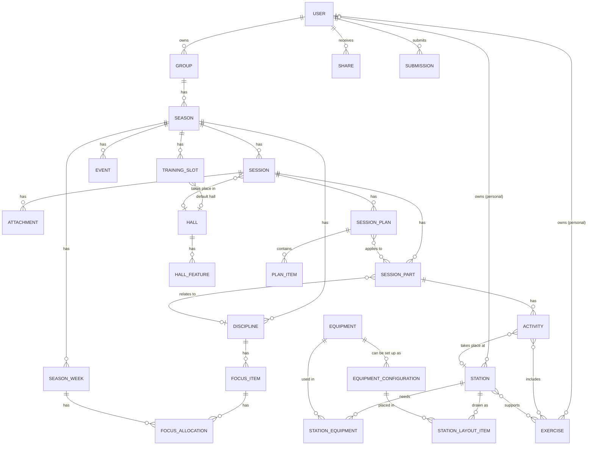

# Data model

Conceptual data model for GymnasticsPlanner: a web platform for planning gymnastics seasons and the training sessions within them.

This document describes entities and their relationships only. Storage, API and UI choices are decided separately.

## Scope of the first version

In scope:

- Season plans: what to focus on during which weeks.
- Text-based session plans derived from the season plan.
- A library of reusable exercises and stations.
- Global library content maintained by administrators, with coaches able to submit their own for review.
- Sharing groups, seasons and sessions with other users (help coaches).
- An optional free-text note on each session about how it went.
- Drawn plans: halls, station layouts and session plans drawn to scale (see [Drawn plans](#drawn-plans)).

Out of scope:

- Gymnasts and attendance (recorded in a separate system).

## Overview

Two relationships are left out of the diagram to keep it readable: a share points at exactly one group, season or session, and a submission points at exactly one exercise or station.

## Users and sharing

### User

A person who signs in: a coach or a help coach.

- Name
- Email
- Administrator flag (administrators maintain the global library and review submissions)

### Share

Gives another user access to a group, a season or a session.

- The invited email address (the person's Google address, matched without regard to case)
- The user who receives access, once known
- The shared resource: exactly one group, season or session
- Access level: view or edit
- Created by (user) and when

A person has at most one share per resource; sharing again changes its level.

The owner shares by typing the email address. The person need not have signed in yet: the share then waits, without a user, and starts working the first time someone signs in with that address. No email is sent.

Rules:

- Every group has one owner, the user who created it. Seasons and sessions belong to the group and so have the same owner.
- Only the owner can share, change or remove shares, delete groups, seasons and the shares on them, and copy seasons.
- Access is inherited downwards. Sharing a group gives access to all its seasons and sessions. Sharing a season gives access to all its sessions. Sharing a session gives access to that session only. When several shares apply, the highest level wins.
- Someone with only some seasons of a group, or only some sessions of a season, sees the group with just those seasons or sessions in it and can open nothing else in it.
- View access is read-only, with one exception: on the session page anyone who can view the session can tick parts off, reset the ticks and write the note after the session. Everything else (the season plan, its structure, sessions, their outlines and times, cancelling, copying) needs edit access.
- Someone with edit access to a session can link their own personal exercises and stations into it. Links to items the editor cannot see in the library stay when they edit the session.
- Someone with access to a session can read the personal exercises and stations it links to, even though they belong to another user. They cannot edit them or open them in the library. Global library content is readable by everyone.

## Season level

### Group

A team that is coached.

- Name (example: Trupp 5)
- Owner (user)

### Season

One term for one group.

- Name (example: 2026 HT)
- Group
- First and last week (example: weeks 34–50 of 2026)

A new season can be created as a copy of an earlier one. The copy includes its training slots, disciplines and focus items.

### Training slot

A recurring training time during a season. Training times can differ between seasons, so slots belong to the season and not to the group. The season's sessions are generated from these.

- Season
- Weekday (example: Monday, Wednesday, Sunday)
- Start and end time (optional)
- Location (optional free text)
- Hall (optional; the default hall for this training day, example: C-salen on Mondays, AB-hallen on Wednesdays and Sundays)

When a slot's hall is changed in the season settings and the slot has stored sessions that have not passed (dated today or later) with another hall, the user is asked whether to change their hall too, and is shown how many there are. Saying no leaves them as they are. Placeholders always show the slot's current hall. Copying a season copies each slot's hall.

### Season week

One week within a season. Exists so that a week can carry information of its own.

- ISO year and week number
- Break flag (example: week 44, no regular training)
- Note (optional)

### Discipline

A top-level section of the season plan. Defined per season, and copied from an earlier season when a new one is created.

- Name (example: Fristående, Tumbling, Trampett, Styrka)
- Sort order

### Focus item

One row in the season plan.

- Name (example: Öva svårigheter, Mjuk landning, Peak + maxning)
- Discipline
- Category (optional; example: Öva på, Redskap, Landing, Fas)
- Sort order

Which apparatus is used during a period (example: Airtrack weeks 34–38, then Tumbling) is modelled as focus items in the category Redskap, not as a separate entity.

### Focus level

How much attention a focus item gets in a given week. A fixed scale, not configurable per season:

| Level | Meaning |
|---|---|
| High | Mycket fokus |
| Medium | Visst fokus |
| Low | Tränas, men inte fokus |
| None | Tränas inte alls (no allocation stored) |

### Focus allocation

One coloured cell in the season plan.

- Focus item
- Season week
- Focus level (high, medium or low)

There is at most one allocation per focus item and week. No allocation means the item is not trained that week.

### Event

A dated activity during the season.

- Name (example: Falun, Nordfemman, Inför NF)
- Type (example: Tävling, Läger, Uppvisning)
- Start and end date
- Description (optional free text, up to 5000 characters; edited on the week page, shown on the week page and the start page)

Only users who can open the season see its events.

## Session level

### Session

One training occasion for a group.

- Season
- Date, with start and end time (optional)
- Location (optional free text)
- Hall (optional; copied from the training slot when the session is first stored, and can be changed for this session)
- Training slot (optional; the recurring slot the session was created from)
- Cancelled flag (a cancelled session keeps its content)
- Note after the session (optional free text about how it went)

A week shows one session per training slot. Until a slot's session for a week is first edited it is only a placeholder and nothing is stored; the first edit stores it, copying the slot's date, times, location and hall. From then on the session keeps its own date, times, location and hall even if the slot changes (for the hall, unless the user agrees to update the slot's upcoming sessions; see Training slot). A placeholder shows its slot's hall. A session having a hall does not mean it has a drawing; a session plan is optional (see Session plan). There is at most one session per training slot and date. Sessions without a training slot are extra sessions added by hand; only those can be deleted. A break week shows no placeholders, but sessions stored in it are still shown.

The focus for a session's week is not stored on the session. It is computed from the focus allocations for that week and shown while planning.

### Session part

An ordered entry in a session's agenda.

- Title (example: Samling, Mjukning, Trampett, Paus, Teknikstationer)
- Sort order
- Duration in minutes (optional; with the session's start time it gives the clock time of each part)
- Discipline (optional)
- Done flag (ticked off during the session)

### Activity

An ordered line under a session part: what the gymnasts do at one place in the hall.

- Station (optional; the equipment setup it takes place at)
- Exercises (zero or more, in order, from the library)
- Text (optional free text; example: + filma ström 3 varv)
- Sort order

All activities of a part run at the same time, typically as a circuit of stations the gymnasts rotate through until the part's time is up. That is why only the part is ticked off, not its activities.

An activity has at least one of exercises or text. This allows, for example:

- A station with exercises from the library.
- A station with only text describing what to do there.
- Only text, without a station or exercises (example: Styrkeövning från program, Fristående-länga).

When a station is chosen, the exercises it supports are offered first. Other exercises can still be added.

A station or exercise used by activities can still be deleted. The activities lose the link and keep everything else; an activity that would be left with neither exercises nor text gets the deleted item's name as its text. Whoever can view a session sees the stations and exercises its activities use, with their details, even when they are another user's personal items.

### Attachment

A file attached to a whole session, such as a photo of a station layout or a PDF with a strength program.

- Session
- Stored file (its path in the private file store)
- Original file name
- Content type: JPEG, PNG, WebP or HEIC photo, or PDF
- Size in bytes, at most 10 MB
- Uploaded by (user) and when

Attachments are listed oldest first. Anyone who can view the session can open its attachments; uploading and deleting need edit access. Uploading to a slot's placeholder stores the session first, like any other first edit.

Copying another session's content into a session also adds the source's attachments to the ones the session already has. The copies point at the same stored files; nothing is uploaded again. A stored file is deleted only when no attachment refers to it any more: when its last attachment is deleted, or its last session, season or group.

## Library

The library holds exercises and stations that are reused across groups and seasons.

### Global and personal

Exercises and stations each have a scope:

- **Global:** visible to all users. Only administrators create, edit and delete them.
- **Personal:** visible to their owner, who creates and edits them.

When an administrator creates an item they choose personal (the default) or global. An administrator can also turn one of their own personal items global directly, without review. A global item cannot be made personal again.

Every item remembers who created it. The creator is kept when the item becomes global, but only administrators are shown it ("Skapad av …"); other users never receive it.

A user can copy a global exercise or station into a personal one to adapt it. The copy is independent of the original. A copied station keeps its equipment lines, its layout and its links to the exercises the user can see (global ones and the user's own); a copied exercise keeps its links to the stations the user can see.

A coach can submit a personal exercise or station for review to make it global, see [Submission](#submission).

An administrator deleting a global item is told how many activities use it, across all users. As with personal items, the activities lose the link, and an activity that would be left with neither exercises nor text gets the item's name as its text.

### Exercise

A reusable exercise.

- Name (example: Grupperad volt till rygg, Pikerat handstående)
- Description (optional)
- Discipline name (optional, as free text, since disciplines are defined per season)
- Scope: global or personal
- Owner (user; personal exercises only)
- Created by (user; kept when it becomes global, shown to administrators only)

An exercise does not list equipment. Equipment belongs to the station it is performed at.

What to focus on in a given session is written in the activity's text, not on the exercise. Alternative (easier or harder) exercises are other exercises supported by the same station.

### Station

A configuration of equipment that one or more exercises can be performed at.

- Name (example: Bakvänd trampett till tjockmatta med kil ovanpå)
- Description (optional)
- Needed equipment (example: Plint, Trampett, Tjockmatta, Kil)
- Supported exercises (example: Grupperad volt till rygg, Pikerad volt till rygg, Sträckt volt till rygg, Kobett salto)
- Scope: global or personal
- Owner (user; personal stations only)
- Created by (user; kept when it becomes global, shown to administrators only)

Some stations support one or two exercises and some support many. An exercise can be supported by several stations.

Rules for which exercises a station supports:

- Administrators maintain the links between global stations and global exercises.
- A user maintains the links that involve their own personal station or personal exercise. This lets a coach add a personal exercise to a global station. That link is visible only to that coach and to those they share sessions with.
- Every list of supported exercises (or supporting stations) shows only the items the viewer can see. Saving such a list adds or removes only the links the user may change and leaves every other link as it is.
- When a station becomes global, its links to personal exercises stay; they are shown only to those who can see the exercises.

### Station equipment

One line in a station's list of needed equipment.

- Station
- Equipment
- Quantity (example: 2 × Tunnmatta)

### Equipment

A type of equipment found in a hall. A single catalogue that all users can read and only administrators can edit.

- Name (example: Plint, Trampett, Tjockmatta, Kil, Tunnmatta, Skumplint)
- Configurations (zero or more; see below), one of them the default

Equipment without a configuration cannot be placed in a drawing. A station's layout simply leaves it out.

Equipment, or one of its configurations, that is fixed in a hall (see Hall feature) cannot be deleted from the catalogue.

### Equipment configuration

One way a piece of equipment can be set up, each seen from above with its own size and look. Maintained by administrators with the equipment.

- Equipment
- Name (example for a tunnmatta: Liggande, Stående på långsidan, Stående på kortsidan, Lutad)
- Width and length, of what it covers on the floor in this configuration, stored in whole centimetres (1–5000) and shown as "200 × 100 cm"; drawings work in metres. Seen from above, the width runs across (x) and the length along (y)
- Image (optional; seen from above, uploaded by an administrator and stretched to the width and length when drawn, whatever its own proportions)
- Colour (optional; when there is no image, the configuration is drawn as a filled rectangle in this colour)
- Sort order
- Default (at most one per equipment)

The name is unique per equipment, ignoring case. The first configuration becomes the default; when the default is deleted, the first remaining one in order becomes the default. Images are PNG, JPEG or WebP, at most 5 MB. When there is neither image nor colour, the configuration is drawn in a neutral grey with an outline.

Equipment that is only ever used one way has a single configuration. When equipment is placed in a drawing its default configuration is used, and the configuration can be changed on the placed item.

### Submission

A request from a coach to make a personal exercise or station global. A station submission can include personal exercises it supports, so they become global with it.

- The submitted item: exactly one exercise or station
- Submitted by (user) and when
- Status: pending, approved or rejected
- Reviewed by (administrator) and when
- Review comment (optional; example: the reason for a rejection)
- Included exercises (station submissions only): personal exercises of the submitter that the station supports, chosen by the submitter to go global with it

Rules:

- Only the owner of a personal item submits it. Administrators make their own items global directly instead.
- While a submission is pending, the owner can still edit the item and can withdraw the submission, which deletes it.
- Administrators see the pending submissions with who submitted them and when, and can open the item to review it even though it is another user's personal item.
- On approval the item itself becomes global. It is not duplicated, so sessions that already use it keep working. The submitter can no longer edit it.
- On rejection a comment is required. The item stays personal and the submitter sees the status and the comment on it. It can be changed and submitted again.
- An item has at most one pending submission; the database enforces it. Reviewed submissions are kept, and the submitter sees the status of their newest one. Submissions are deleted with their item.
- No email is sent; the submitter sees pending, approved or rejected on the item.
- When submitting a station that supports personal exercises of their own, the submitter ticks which of them to include (all at first). Only personal exercises they own that the station supports can be included.
- While a station submission is pending, administrators can also read its included exercises (and no other personal items), and the submitter sees on each that it is under review with the station; it cannot be submitted on its own meanwhile. Withdrawing the station submission removes the inclusion.
- On approval of a station the administrator ticks which included exercises become global with it (all at first). The station and the ticked exercises become global in one transaction; each exercise is checked again (still personal, still the submitter's, still supported by the station). An exercise that becomes global this way keeps its creator, and a pending submission of its own is marked approved. Included exercises that were not ticked stay personal, and the submitter is told which became global and which stayed personal. A rejection rejects the whole submission and nothing becomes global.
- An administrator making their own station global ticks which of their own personal exercises it supports become global with it (all at first).

## Drawn plans

A drawn plan shows, to scale and seen from above, where the equipment and stations stand in a hall. It complements the text plan; it does not replace it. All sizes and positions are in metres. A position is the centre of an item, measured from the hall's top-left corner, and a rotation is in degrees clockwise.

### Hall

A training hall. Halls are global: they belong to the library, every user can read them, and only administrators create and edit them.

- Name (example: C-salen, AB-hallen), unique ignoring case
- Width and length, typed in metres with decimals (example: 24,5 × 42 m) and stored in whole centimetres (1–20000), like equipment sizes
- Floor: colour, optional image stretched to the hall's size. The colour is a light wood (#ece3d0) at first; the image is PNG, JPEG or WebP of at most 5 MB, stored and served like feature images. The floor is drawn under all features and plan items.
- Fixed features (see below), in layer order

A training slot can name a default hall, and a session can use another hall than its slot's. Deleting a hall is not blocked: the training slots and sessions that used it are left without a hall.

A hall is saved as a whole, with its floor and all its features, in one transaction, and checked on the server; referenced equipment and configurations must exist.

### Hall feature

Something fixed in a hall, drawn in every plan for that hall and not movable there.

- Hall
- Kind: wall bars (ribbstol), door (dörr), port, storage (förråd), wall (vägg), foam pit (skumgrop), MD pit (MD-grop), stands (läktare), other (övrigt) or equipment
- For equipment: one of the catalogue's equipment and one of its configurations, fixed in the hall (example: a tumbling track that always lies out). Its size and look come from the configuration.
- For every other kind: width and length in whole centimetres (1–20000), a colour, and an optional image seen from above, stretched to the width and length like a configuration's image. MD pits, for example, differ in size and colour between halls.
- Position (its centre, from the hall's top-left corner) and rotation
- Layer order (higher is drawn on top)
- Label (optional; example: Förråd, Port till AB-hallen)

Each kind has a default colour and, without an image, a look of its own, so that a hall can be drawn as close to reality as possible: wall bars striped, storage hatched, a wall solid dark grey, pits filled, a door and a port as an opening, stands as rows. Images are PNG, JPEG or WebP of at most 5 MB, as for configurations. Sizes are typed in centimetres; positions are set by dragging, snapped to 0.5 m at first.

### Station layout item

One thing drawn in a station's layout. Together they are the station's visual representation, seen from above around the station's centre.

- Station
- Kind, with what that kind needs:
  - **Equipment:** one piece of the equipment the station needs, and one of its configurations (example: Tunnmatta, Lutad).
  - **Arrow:** a length (example: the direction of run-up to a trampett).
  - **Text:** a short text (example: Ansats).
- Position relative to the station's centre, in whole centimetres, and rotation
- Layer order (higher is drawn on top; example: a kil on a tjockmatta)
- Label (optional short text; example: 2 delar)

Arrows and texts are the same item kinds as in session plans, and are drawn the same way in both.

Rules:

- Only equipment the station needs can be placed, and at most as many as its quantity (2 × Tunnmatta can be placed twice), each with a configuration of that equipment. Equipment the station needs but that is not placed is not drawn.
- Whoever may edit the station may edit its layout: the owner of a personal station, administrators for a global one. Everyone who can read the station can read its layout, including those who see it through a session's activities.
- The layout is saved with the station, as a whole. When the station's equipment changes (a line is removed or its quantity lowered), placed items that no longer fit are removed when the station is saved, the topmost first, and the user is told how many. The server enforces this.
- Copying a station into a personal one copies its layout. A station submitted for review brings its layout, and the administrator sees the drawing when reviewing it; approval makes the station itself global, layout included.
- A station without layout items has no picture. Lists and the activity search dialog draw a station that has a layout small, scaled to fit.

### Session plan

A drawing of a session in its hall.

- Session
- Applies to: the whole session (the main plan) or chosen session parts
- Name (optional; example: Banan)

A session has at most one main plan and any number of plans for chosen parts. A part belongs to at most one such plan; a part without one shows the main plan. A new plan can start empty or as a copy of another plan of the same session, since configurations for different parts often differ only a little. A copy keeps its items; links to activities outside the new plan's parts are dropped.

A plan needs a hall: it is drawn on the session's hall, with the floor and the fixed features under the items, which cannot be moved there. A session without a hall gets one chosen before its first plan is drawn. If the session's hall is changed, items keep their positions (whole centimetres from the hall's top-left corner), even if they then lie outside a smaller hall.

When a part with its own plan is deleted, the plan is kept. A part plan left without parts is marked "inga passdelar"; it can be attached to other parts or deleted. Attaching a part to a plan takes it from the plan it had, and links to activities that no longer belong to a plan's parts are removed.

### Plan item

One thing placed in a session plan.

- Session plan
- Kind, with what that kind needs:
  - **Equipment:** the equipment and its configuration.
  - **Station:** the station, and optionally the activity it is used for (an activity in a part the plan applies to), shown as a number that leads to the activity's text. A placed station follows the station's layout in the library, so a change there shows in every plan. "Anpassa" turns it into an adapted copy: its layout items (equipment, arrows and texts) and its name are copied into the plan item and can then be changed for this plan only.
  - **Text:** the text (example: Nedförsbacke skapas med plint 4 + 3 + 2 del).
  - **Area:** width and length, drawn as a dashed outline (example: Lämna tomt här för AG + Parkour).
  - **Person:** a role, Coach or Passare.
  - **Arrow:** a length, for example the direction of run-up to a trampett.
- Position, rotation and layer order
- Label (optional short text; example: 2 delar, Trupp 2)

Rules:

- Who may see and change a session plan follows the session: view access to see it, edit access to change it.
- Everyone who can see a session plan can see the stations and equipment drawn in it, as with the stations its activities link to.
- Station numbers are never typed. They follow the activities' order in the session: parts in order, activities top to bottom, counting only the activities that are linked to a station placed in that plan. The text plan and the drawing therefore match. An activity is linked to at most one placed station per plan.
- When a station is placed and exactly one activity in the plan's parts links to that station, the placed station is linked to that activity. Otherwise the user picks the activity, or leaves it unlinked.
- The station picker lists the stations the plan's parts use first, then the rest of the library the user can see, with search.
- A person is drawn as a circle with the role's initial; an area as a dashed outline with its label inside.
- A plan is saved as a whole, in one transaction, and checked on the server: every referenced station, equipment, configuration and activity must exist, new stations must be visible to the user (stations already in the session's plans or activities stay allowed), each configuration must belong to its equipment, and linked activities must belong to the plan's parts.
- Copying a session's content also copies its plans, replacing the target's plans like its outline. A copied plan applies to the parts at the same positions in the copied outline, and its links follow the copied activities.
- Equipment, or an equipment configuration, drawn in a plan or a station layout cannot be deleted from the catalogue, as with equipment a station needs. A station that is deleted while placed in plans leaves adapted copies in those plans.

## Decisions

- Only a session part has a done flag. All activities of a part happen at the same time (a circuit of stations), so activities are not ticked off one by one.
- Shares have two access levels, view and edit. Only the owner can share, delete and copy.
- A share is made out to an email address and may wait until that person first signs in. Nothing is sent to them.
- Viewers may tick parts off and write the note after a session. These are what a help coach in the hall needs; everything else stays with edit access.
- A help coach with access to only one session edits it on its own page, without the season plan.
- The focus level scale is fixed, not configurable per season.
- Exercises and stations are global or personal. Administrators maintain the global ones, and coaches can submit personal ones for review.
- Training slots belong to the season and are copied when a season is copied.
- There is no program entity. Recurring routines such as a strength program are referred to in an activity's text.
- An activity has an optional station, zero or more exercises and optional text, with at least one of exercises or text.
- Approving a submission converts the item to global instead of creating a global copy.
- Administrators create global items directly and can make their own personal items global without review.
- A pending submission does not lock the item: the owner can keep editing it and can withdraw it.
- The creator of a global item is kept but shown only to administrators.
- Links between stations and exercises are saved per link: a save only changes the links the user may change, so a coach's personal exercises on a global station survive an administrator's edit, and the other way round.
- A station submission can include the submitter's personal exercises that the station supports, and the administrator chooses which of them become global with the station. Personal exercises that are not included, or not chosen, stay personal; their links to the now global station stay and are visible only to those who can see the exercise.
- An exercise has no focus cues or easier/harder variants. Focus points are written in the activity's text for the session, and alternative exercises are other exercises supported by the same station.
- Equipment is one catalogue shared by all users. Only administrators can add, rename and remove entries and their configurations.
- Equipment can have several configurations (example: a mat lying flat, standing on its long or short side, or leaning), each with its own size, image and colour. A placed item records which configuration it shows.
- Halls are global library items maintained by administrators. A training slot has a default hall and a session may use another.
- A session gets its slot's hall when it is first stored. Changing a slot's hall offers to update the slot's stored sessions that have not passed; earlier sessions keep the hall they were held in.
- Deleting a hall leaves its slots and sessions without a hall rather than being blocked.
- Hall features have their own size, colour and image, like equipment configurations, and catalogue equipment can be fixed in a hall.
- A session has a main plan and optional plans for chosen parts, rather than one plan per part.
- A station placed in a plan follows its library layout until it is adapted, which turns it into a copy for that plan.
- Plans are drawn with equipment, stations, text, areas, people (Coach, Passare) and arrows. There are no free lines.
- Drawn plans are edited on a desktop and read on a phone. There is no import of earlier drawings.
- On the phone's session page a plan is opened on demand from its part, never shown automatically: the stations are built before the session, so the drawing is needed only when the coach chooses to look. A part shows its own plan, or else the main plan.
- Printing follows view access: anyone who can see a session's plans can print them, one plan per page, or save one as an image.
- Attachments belong to a whole session, not to a part or an activity. Only photos and PDFs up to 10 MB are accepted; no video. The type is checked against the file's first bytes, not its name.
- Copying a session's content adds its attachments to the target's own instead of replacing them, so files uploaded to the target are never lost by a copy.
