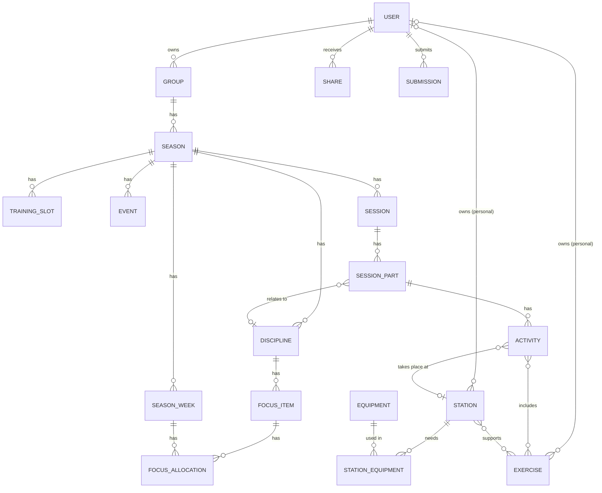

# Data model

Conceptual data model for GymnasticsPlanner: a web platform for planning gymnastics seasons and the training sessions within them.

This document describes entities and their relationships only. Storage, API and UI choices are decided separately.

## Scope of the first version

In scope:

- Season plans: what to focus on during which weeks.
- Text-based session plans derived from the season plan.
- A library of reusable exercises and stations.
- Global library content maintained by administrators, with coaches able to submit their own for review.
- Sharing groups, seasons and sessions with other users (help coaches).
- An optional free-text note on each session about how it went.

Out of scope:

- Drawn station layouts of the hall (planned for a later version, see [Later: drawn plans](#later-drawn-plans)).
- Gymnasts and attendance (recorded in a separate system).

## Overview

Two relationships are left out of the diagram to keep it readable: a share points at exactly one group, season or session, and a submission points at exactly one exercise or station.

## Users and sharing

### User

A person who signs in: a coach or a help coach.

- Name
- Email
- Administrator flag (administrators maintain the global library and review submissions)

### Share

Gives another user access to a group, a season or a session.

- The invited email address (the person's Google address, matched without regard to case)
- The user who receives access, once known
- The shared resource: exactly one group, season or session
- Access level: view or edit
- Created by (user) and when

A person has at most one share per resource; sharing again changes its level.

The owner shares by typing the email address. The person need not have signed in yet: the share then waits, without a user, and starts working the first time someone signs in with that address. No email is sent.

Rules:

- Every group has one owner, the user who created it. Seasons and sessions belong to the group and so have the same owner.
- Only the owner can share, change or remove shares, delete groups, seasons and the shares on them, and copy seasons.
- Access is inherited downwards. Sharing a group gives access to all its seasons and sessions. Sharing a season gives access to all its sessions. Sharing a session gives access to that session only. When several shares apply, the highest level wins.
- Someone with only some seasons of a group, or only some sessions of a season, sees the group with just those seasons or sessions in it and can open nothing else in it.
- View access is read-only, with one exception: on the session page anyone who can view the session can tick parts off, reset the ticks and write the note after the session. Everything else (the season plan, its structure, sessions, their outlines and times, cancelling, copying) needs edit access.
- Someone with edit access to a session can link their own personal exercises and stations into it. Links to items the editor cannot see in the library stay when they edit the session.
- Someone with access to a session can read the personal exercises and stations it links to, even though they belong to another user. They cannot edit them or open them in the library. Global library content is readable by everyone.

## Season level

### Group

A team that is coached.

- Name (example: Trupp 5)
- Owner (user)

### Season

One term for one group.

- Name (example: 2026 HT)
- Group
- First and last week (example: weeks 34–50 of 2026)

A new season can be created as a copy of an earlier one. The copy includes its training slots, disciplines and focus items.

### Training slot

A recurring training time during a season. Training times can differ between seasons, so slots belong to the season and not to the group. The season's sessions are generated from these.

- Season
- Weekday (example: Monday, Wednesday, Sunday)
- Start and end time (optional)
- Location (optional)

### Season week

One week within a season. Exists so that a week can carry information of its own.

- ISO year and week number
- Break flag (example: week 44, no regular training)
- Note (optional)

### Discipline

A top-level section of the season plan. Defined per season, and copied from an earlier season when a new one is created.

- Name (example: Fristående, Tumbling, Trampett, Styrka)
- Sort order

### Focus item

One row in the season plan.

- Name (example: Öva svårigheter, Mjuk landning, Peak + maxning)
- Discipline
- Category (optional; example: Öva på, Redskap, Landing, Fas)
- Sort order

Which apparatus is used during a period (example: Airtrack weeks 34–38, then Tumbling) is modelled as focus items in the category Redskap, not as a separate entity.

### Focus level

How much attention a focus item gets in a given week. A fixed scale, not configurable per season:

| Level | Meaning |
|---|---|
| High | Mycket fokus |
| Medium | Visst fokus |
| Low | Tränas, men inte fokus |
| None | Tränas inte alls (no allocation stored) |

### Focus allocation

One coloured cell in the season plan.

- Focus item
- Season week
- Focus level (high, medium or low)

There is at most one allocation per focus item and week. No allocation means the item is not trained that week.

### Event

A dated activity during the season.

- Name (example: Falun, Nordfemman, Inför NF)
- Type (example: Tävling, Läger, Uppvisning)
- Start and end date

## Session level

### Session

One training occasion for a group.

- Season
- Date, with start and end time (optional)
- Location (optional)
- Training slot (optional; the recurring slot the session was created from)
- Cancelled flag (a cancelled session keeps its content)
- Note after the session (optional free text about how it went)

A week shows one session per training slot. Until a slot's session for a week is first edited it is only a placeholder and nothing is stored; the first edit stores it, copying the slot's date, times and location. From then on the session keeps its own date, times and location even if the slot changes. There is at most one session per training slot and date. Sessions without a training slot are extra sessions added by hand; only those can be deleted. A break week shows no placeholders, but sessions stored in it are still shown.

The focus for a session's week is not stored on the session. It is computed from the focus allocations for that week and shown while planning.

### Session part

An ordered entry in a session's agenda.

- Title (example: Samling, Mjukning, Trampett, Paus, Teknikstationer)
- Sort order
- Duration in minutes (optional; with the session's start time it gives the clock time of each part)
- Discipline (optional)
- Done flag (ticked off during the session)

### Activity

An ordered line under a session part: what the gymnasts do at one place in the hall.

- Station (optional; the equipment setup it takes place at)
- Exercises (zero or more, in order, from the library)
- Text (optional free text; example: + filma ström 3 varv)
- Sort order

All activities of a part run at the same time, typically as a circuit of stations the gymnasts rotate through until the part's time is up. That is why only the part is ticked off, not its activities.

An activity has at least one of exercises or text. This allows, for example:

- A station with exercises from the library.
- A station with only text describing what to do there.
- Only text, without a station or exercises (example: Styrkeövning från program, Fristående-länga).

When a station is chosen, the exercises it supports are offered first. Other exercises can still be added.

A station or exercise used by activities can still be deleted. The activities lose the link and keep everything else; an activity that would be left with neither exercises nor text gets the deleted item's name as its text. Whoever can view a session sees the stations and exercises its activities use, with their details, even when they are another user's personal items.

## Library

The library holds exercises and stations that are reused across groups and seasons.

### Global and personal

Exercises and stations each have a scope:

- **Global:** visible to all users. Only administrators create and edit them.
- **Personal:** visible to their owner, who creates and edits them.

A user can copy a global exercise or station into a personal one to adapt it. The copy is independent of the original.

A coach can submit a personal exercise or station for review to make it global, see [Submission](#submission).

### Exercise

A reusable exercise.

- Name (example: Grupperad volt till rygg, Pikerat handstående)
- Description (optional)
- Discipline name (optional, as free text, since disciplines are defined per season)
- Scope: global or personal
- Owner (user; personal exercises only)

An exercise does not list equipment. Equipment belongs to the station it is performed at.

What to focus on in a given session is written in the activity's text, not on the exercise. Alternative (easier or harder) exercises are other exercises supported by the same station.

### Station

A configuration of equipment that one or more exercises can be performed at.

- Name (example: Bakvänd trampett till tjockmatta med kil ovanpå)
- Description (optional)
- Needed equipment (example: Plint, Trampett, Tjockmatta, Kil)
- Supported exercises (example: Grupperad volt till rygg, Pikerad volt till rygg, Sträckt volt till rygg, Kobett salto)
- Scope: global or personal
- Owner (user; personal stations only)

Some stations support one or two exercises and some support many. An exercise can be supported by several stations.

Rules for which exercises a station supports:

- Administrators maintain the links between global stations and global exercises.
- A user maintains the links that involve their own personal station or personal exercise. This lets a coach add a personal exercise to a global station. That link is visible only to that coach and to those they share sessions with.

### Station equipment

One line in a station's list of needed equipment.

- Station
- Equipment
- Quantity (example: 2 × Tunnmatta)

### Equipment

A type of equipment found in a hall. A single catalogue that all users can read and only administrators can edit.

- Name (example: Plint, Trampett, Tjockmatta, Kil, Tunnmatta, Skumplint)

### Submission

A request from a coach to make a personal exercise or station global.

- The submitted item: exactly one exercise or station
- Submitted by (user) and when
- Status: pending, approved or rejected
- Reviewed by (administrator) and when
- Review comment (optional; example: the reason for a rejection)

Rules:

- On approval the item itself becomes global. It is not duplicated, so sessions that already use it keep working. The submitter can no longer edit it.
- On rejection the item stays personal and the submitter sees the review comment. It can be changed and submitted again.
- An item has at most one pending submission.

## Later: drawn plans

In a drawn plan, an activity's station is placed in the hall. A later version can add the entities below without changing the text model:

- Hall: the room and its fixed features (doors, wall bars, storage).
- Size and colour on equipment, so that it can be drawn.
- Placement: where a station's equipment, its label and a spotter sit in the hall for a given session.

## Decisions

- Only a session part has a done flag. All activities of a part happen at the same time (a circuit of stations), so activities are not ticked off one by one.
- Shares have two access levels, view and edit. Only the owner can share, delete and copy.
- A share is made out to an email address and may wait until that person first signs in. Nothing is sent to them.
- Viewers may tick parts off and write the note after a session. These are what a help coach in the hall needs; everything else stays with edit access.
- A help coach with access to only one session edits it on its own page, without the season plan.
- The focus level scale is fixed, not configurable per season.
- Exercises and stations are global or personal. Administrators maintain the global ones, and coaches can submit personal ones for review.
- Training slots belong to the season and are copied when a season is copied.
- There is no program entity. Recurring routines such as a strength program are referred to in an activity's text.
- An activity has an optional station, zero or more exercises and optional text, with at least one of exercises or text.
- Approving a submission converts the item to global instead of creating a global copy.
- When a station is approved, only its links to global exercises become global. Personal exercises it supports must be submitted separately.
- An exercise has no focus cues or easier/harder variants. Focus points are written in the activity's text for the session, and alternative exercises are other exercises supported by the same station.
- Equipment is one catalogue shared by all users. Only administrators can add, rename and remove entries.
